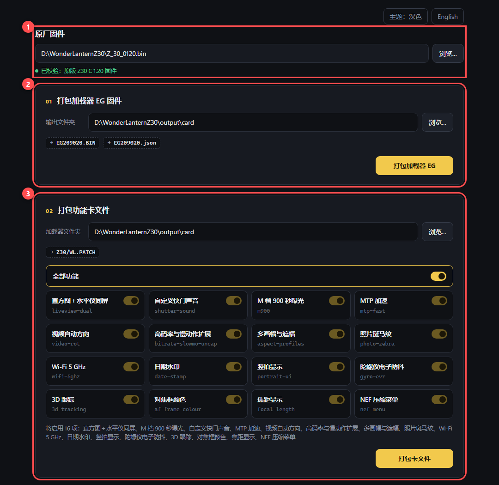
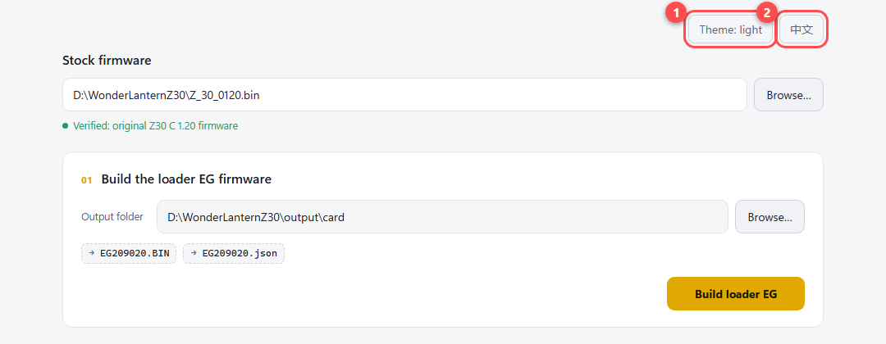
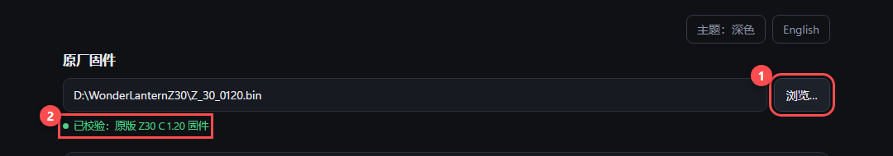
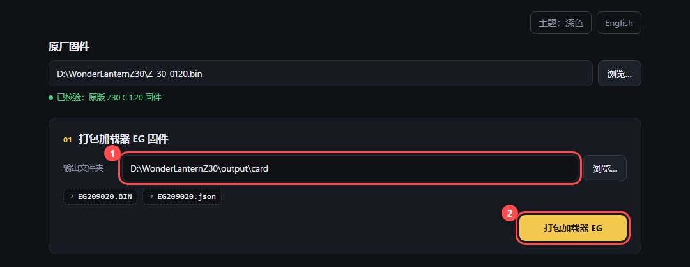
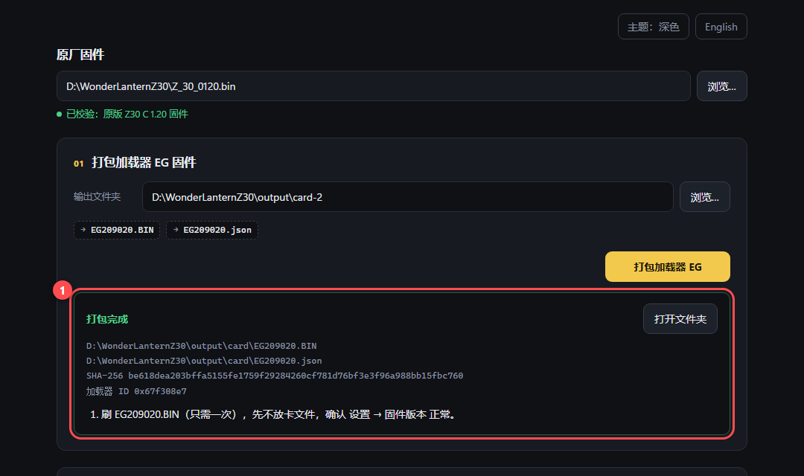
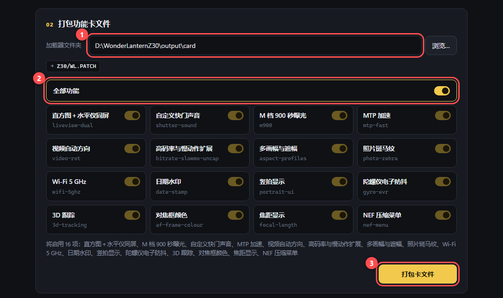
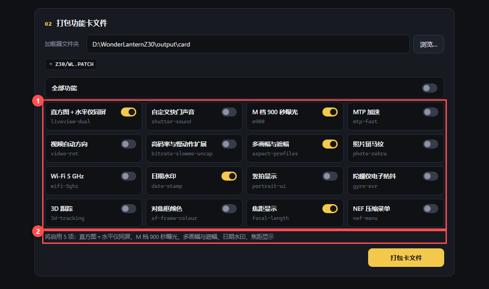
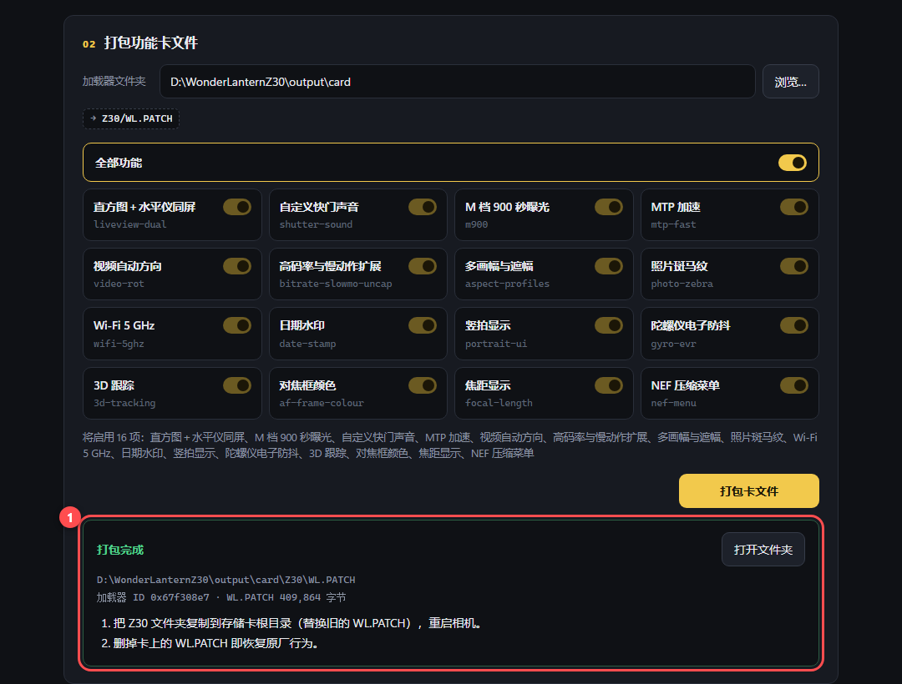
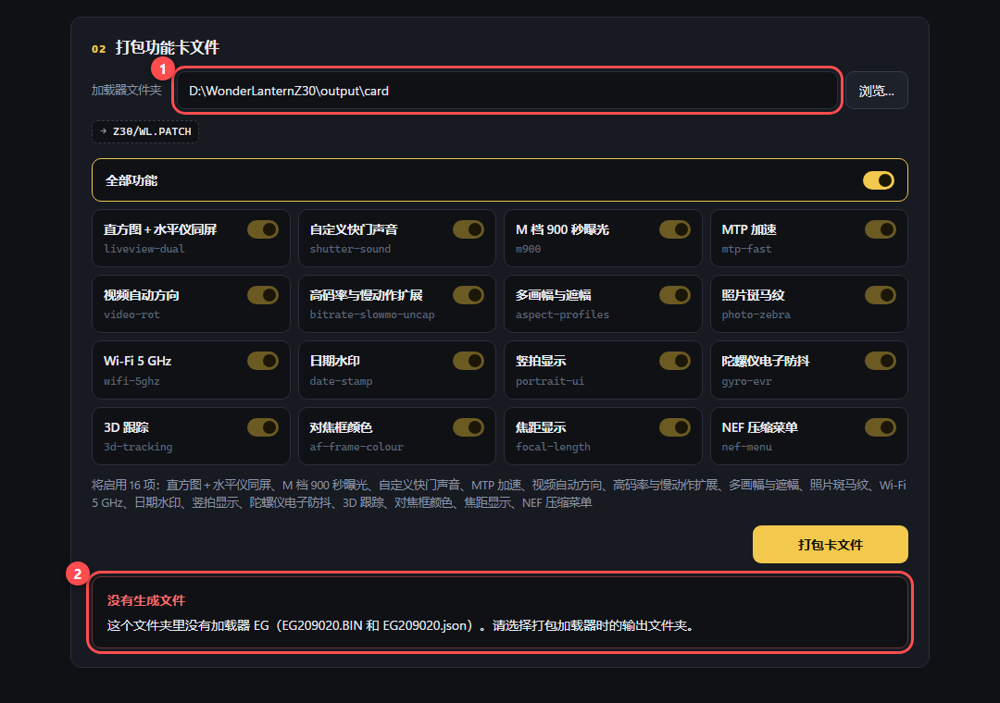

# GUI packaging tutorial

[简体中文](gui-tutorial.md) · **English**

A step-by-step walk through the Windows packaging program `WonderLanternZ30.exe`: building the **loader firmware** and the **feature card file**, and installing them on a Nikon Z30. No Python and no command line are needed.

> [!NOTE]
> The paths `D:\WonderLanternZ30\…` in the screenshots are examples; the program shows the folder it actually runs from. The interface follows the system language; most screenshots show the Chinese dark theme, and the English labels are given in the text.

> [!WARNING]
> Modifying firmware carries risk. Keep an unmodified `Z_30_0120.bin`, and make sure you know how to update through **Setup menu → Firmware version**: as long as that page opens, you can flash the stock firmware back.

## Overview

| Step | What | How often |
| --- | --- | --- |
| 1 | Download the program, prepare the stock firmware | once |
| 2 | Build the **loader EG** (`EG209020.BIN`) and flash it | once (unless the program asks for a loader update) |
| 3 | Build the **feature card file** (`Z30/WL.PATCH`) and copy it to the card | whenever you change features or update |

The program only writes files on the computer. It never connects to the camera or writes the SD card; copying and flashing are up to you.

## 1. Download the program and prepare the firmware

1. Download `WonderLanternZ30-windows-x64.zip` from the [Releases page](https://github.com/WonderLantern/wonder-lantern-z30/releases/latest).
2. **Extract the whole archive** to a folder (for example `D:\WonderLanternZ30`). Do not run it from inside the zip.
3. Put Nikon's Z30 C 1.20 firmware `Z_30_0120.bin` into that folder, next to `WonderLanternZ30.exe`; the program finds it on start.

| Item | Value |
| --- | --- |
| File | `Z_30_0120.bin`, 34,496,798 bytes |
| SHA-256 | `1a5449ef505f1f347ed4e066a6a3f588ea542240680e83f4ebcae3b16da3434a` |

```text
D:\WonderLanternZ30\
├─ WonderLanternZ30.exe
├─ _internal\            ← the program's runtime, keep it
├─ licenses\
└─ Z_30_0120.bin         ← the stock firmware you supply
```

> [!TIP]
> The program is not code-signed, so Windows SmartScreen may warn on the first start. Check the zip's SHA-256 against the Release page, then choose "More info → Run anyway". It needs the Microsoft Edge WebView2 runtime that comes with Windows 10/11.

## 2. The window



1. **Stock firmware**: choose `Z_30_0120.bin`; the check result appears below it.
2. **01 Build the loader EG firmware**: writes `EG209020.BIN`, flashed once.
3. **02 Build the feature card file**: pick features and write `Z30/WL.PATCH` for the card.

The two buttons at the top right switch the theme (system / light / dark) and the language:



## 3. Check the stock firmware

With `Z_30_0120.bin` next to the program the path is filled in and checked automatically. Otherwise click **Browse…** (①) or paste the full path.



Continue only when the green **"Verified: original Z30 C 1.20 firmware"** (②) appears. A red **"Does not match"** means the file was modified, truncated or is another version; download C 1.20 from Nikon again.


## 4. Build the loader EG (once)

The loader firmware is the stock firmware plus a Chinese font with the common characters and a loader that reads the card file. Without a card file the camera behaves like stock.



1. **Output folder** (①) defaults to `output\card` next to the program. The program never overwrites files, so each build gets a fresh folder (`card`, `card-2`, …).
2. Click **Build loader EG** (②) and wait.



- `EG209020.BIN` is flashed to the camera; `EG209020.json` records the loader's identity and capabilities and is needed for every card file. **Keep both together in this folder.**
- The **SHA-256** matches the loader SHA-256 on the Release page.
- **Open folder** opens the output location.
- Afterwards the output folder above moves on to the next empty folder, and **Loader folder** below points at the loader just built.

### Flash it

1. Copy `EG209020.BIN` to the **root** of the memory card (no `Z30` folder on the card yet).
2. With a charged battery, open **Setup menu → Firmware version** and follow the update prompts. Do not switch off or remove the card while it updates.
3. Restart and check that menus, stills and video behave like stock, and that **Firmware version** still opens, now with two extra lines for the project name and copyright.
4. You can then delete `EG209020.BIN` from the card.

## 5. Build the feature card file



1. **Loader folder** (①) must be the folder of the `EG209020.BIN` **that is on the camera**. It is filled in after a loader build; on a later start it points at the newest loader folder under `output`.
2. **Everything** (②) is on by default and includes all sixteen features.
3. Click **Build card file** (③).

To pick features yourself, switch **Everything** off and turn on what you want. Hover a feature for its description; the summary (②) lists what will actually be enabled, including the menu framework some features bring along.





The **Loader id** must match the one from step 4: a card file only loads on that loader.

Click **Open folder** and copy the whole `Z30` folder to the root of the memory card:

```text
card root\
└─ Z30\
   └─ WL.PATCH
```

Start the camera: about 3 seconds later the features appear and photo live view briefly shows **"Wonder Lantern ready · N features"**. The features are under **Setup menu → Extensions**; its first row, Status, shows whether the card file loaded, its version and the feature count. The loader writes `Z30\WL.LOG`; a line starting with `WL.PATCH S=01` means success, the other codes are in the [SD card loader notes](card-loader.md) (Chinese).

## 6. Changing features or updating later

1. Start the (new) program and set **Loader folder** to the loader on the camera.
2. The program never overwrites: move the old `Z30\WL.PATCH` out of that folder first.
3. Pick features, click **Build card file**, replace the file on the card and restart.

No reflash is needed. Only when a new card file needs something the old loader lacks does the program refuse and ask for a loader update; then repeat step 4.

## Back to stock

- **For now:** delete `Z30\WL.PATCH` from the card (or use another card) and restart.
- **For good:** copy the stock `Z_30_0120.bin` to the card root and flash it through **Setup menu → Firmware version**.

## Troubleshooting

| Message or symptom | Cause and fix |
| --- | --- |
| "Does not match" | Not an unmodified Z30 C 1.20 firmware; download it again and compare size and SHA-256 |
| "File not found" | Wrong path; choose the file with Browse… |
| "This folder has no loader EG" | **Loader folder** does not hold `EG209020.BIN` and `EG209020.json`; choose the loader's output folder (below) |
| "Already exists and will not be overwritten" | Move the old `Z30\WL.PATCH` away; for a loader, use a new folder |
| The program asks for a loader update | Build a loader in a new folder, flash it, then build the card file |
| Features do not appear | No `Z30\WL.LOG` on the card means `Z30\WL.PATCH` was not found (check folder name and place); otherwise look up its code in the [SD card loader notes](card-loader.md) |
| The program does not start | Extract the whole zip; make sure the WebView2 runtime is installed |



For the command line and macOS / Linux, see the [README](../README.en.md#quick-start) and the [offline build guide](../PATCH_GUIDE.md) (Chinese).
