# GUI packaging tutorial

[简体中文](gui-tutorial.md) · **English**

A step-by-step walk through the packaging program `WonderLanternZ30`: building the **loader firmware** and the **feature card file**, and installing them on a Nikon Z30. The program comes for Windows, Linux and macOS with the same window on all three; no Python and no command line are needed.

> [!NOTE]
> Paths such as `D:\WonderLanternZ30\…` in the screenshots are examples; the program shows the folder it actually runs from. The interface follows the system language (Chinese or English); the screenshots use English and the dark theme. They are rendered from the program's real page by `tools/make_gui_screenshots.py`.

> [!WARNING]
> Modifying firmware carries risk. Keep an unmodified `Z_30_0120.bin`, and make sure you know how to update through **Setup menu → Firmware version**: as long as that page opens, you can flash the stock firmware back.

## Overview

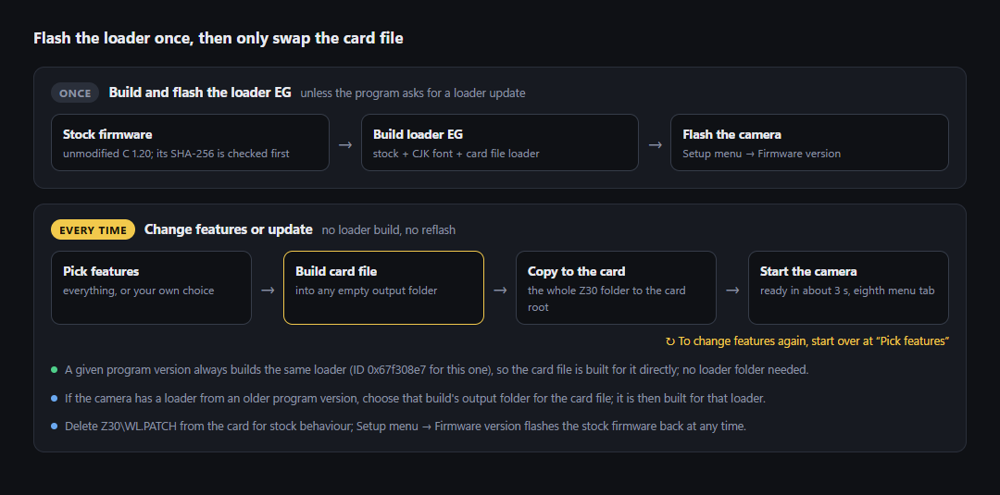

| Step | What | How often |
| --- | --- | --- |
| 1 | Download the program, prepare the stock firmware | once |
| 2 | Build the **loader EG** (`EG209020.BIN`) and flash it | once (unless the program asks for a loader update) |
| 3 | Build the **feature card file** (`Z30/WL.PATCH`) and copy it to the card | whenever you change features or update; **no** new loader build |

The program only writes files on the computer. It never connects to the camera or writes the SD card; copying and flashing are up to you.

## 1. Download the program and prepare the firmware

### 1.1 Download for your system

Download one archive from the [Releases page](https://github.com/WonderLantern/wonder-lantern-z30/releases/latest). All three build byte-identical loaders and card files, and the release build checks that:

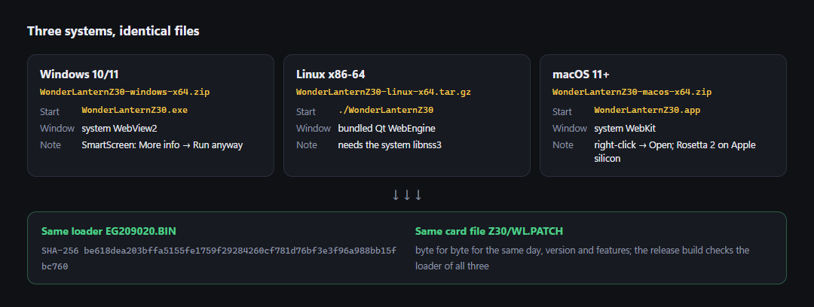

| System | Download | Start after extracting |
| --- | --- | --- |
| Windows 10/11 | `WonderLanternZ30-windows-x64.zip` | `WonderLanternZ30\WonderLanternZ30.exe` |
| Linux x86-64 | `WonderLanternZ30-linux-x64.tar.gz` | `WonderLanternZ30/WonderLanternZ30` |
| macOS 11 or later (Intel and Apple silicon) | `WonderLanternZ30-macos-x64.zip` | `WonderLanternZ30/WonderLanternZ30.app` |

Check the archive's SHA-256 against the Release page if you like. **Extract the whole archive** before starting the program; do not run it from inside the archive.

### 1.2 Add the stock firmware

Put Nikon's Z30 C 1.20 firmware `Z_30_0120.bin` into the extracted `WonderLanternZ30` folder, next to the program; it finds the file on start.

| Item | Value |
| --- | --- |
| File | `Z_30_0120.bin`, 34,496,798 bytes |
| SHA-256 | `1a5449ef505f1f347ed4e066a6a3f588ea542240680e83f4ebcae3b16da3434a` |

**Windows / Linux:**

```text
WonderLanternZ30\
├─ WonderLanternZ30.exe    ← WonderLanternZ30 (no .exe) on Linux
├─ _internal\              ← the program's runtime, keep it
├─ licenses\               ← licences
└─ Z_30_0120.bin           ← the stock firmware you add
```

**macOS:**

```text
WonderLanternZ30/
├─ WonderLanternZ30.app
├─ licenses/
└─ Z_30_0120.bin           ← in the folder that holds the .app
```

Builds go to `output` in the same folder. On macOS, when that folder cannot be written (for example when the app runs quarantined from Downloads), the program uses `~/WonderLanternZ30/output` instead, and the firmware may go in `~/WonderLanternZ30`.

### 1.3 First start

The program is not code-signed, so each system asks once:

| System | What to do |
| --- | --- |
| Windows | When SmartScreen warns, choose "More info → Run anyway". The window is drawn by the Microsoft Edge WebView2 runtime that comes with Windows 10/11 |
| macOS | In Finder, **right-click `WonderLanternZ30.app` → Open** and confirm, or run `xattr -dr com.apple.quarantine WonderLanternZ30.app`. Apple silicon Macs run it through Rosetta 2 and offer to install it the first time |
| Linux | Run `tar -xzf WonderLanternZ30-linux-x64.tar.gz`, then `./WonderLanternZ30/WonderLanternZ30`; later a double-click in the file manager works too. The window is drawn by the bundled Qt WebEngine; the system only needs NSS (`libnss3`, present on desktops with Firefox or Chrome; `sudo apt install libnss3` on Ubuntu/Debian) |

## 2. The window

The window has three parts, top to bottom:

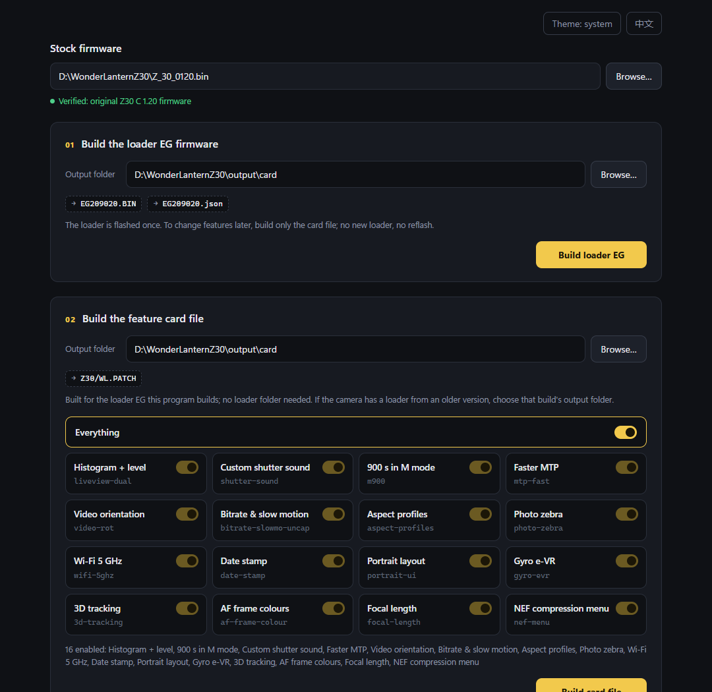

1. **Stock firmware**: choose `Z_30_0120.bin`; the check result appears below.
2. **01 Build the loader EG firmware**: makes the `EG209020.BIN` you flash, **only once**.
3. **02 Build the feature card file**: pick features and make `Z30/WL.PATCH` for the memory card. Later changes only use this part.

The two buttons at the top right switch the theme (①: system / light / dark) and the language (②):


## 3. Check the stock firmware

If `Z_30_0120.bin` is next to the program, the path is filled in and checked on start. Otherwise click **Browse…** (①) or paste the full path.

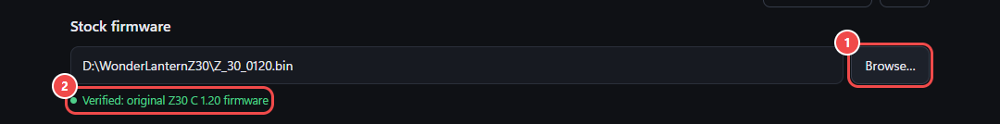

Go on only when the green **"Verified: original Z30 C 1.20 firmware"** (②) appears. A red "Does not match" (①) means the file was modified, is incomplete or is another version; download C 1.20 from Nikon again:

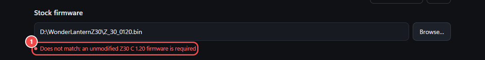

## 4. Build the loader EG (once)

The loader firmware is the stock firmware plus a CJK font with the common characters and a loader that reads the card file. Without a card file the camera behaves as stock.

> [!TIP]
> Already flashed the loader from **this program version**? Skip to step 5.

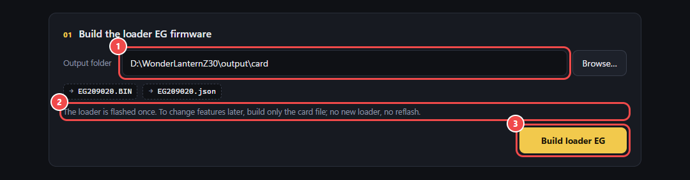

1. **Output folder** (①) defaults to `output\card` next to the program. The program never overwrites files, so each build gets a fresh folder (`card`, `card-2`, …).
2. The note (②) says the loader is flashed only once.
3. Click **Build loader EG** (③). The button shows "Building…" for some seconds to a few minutes.

When it is done, a green **"Done"** (①) appears:

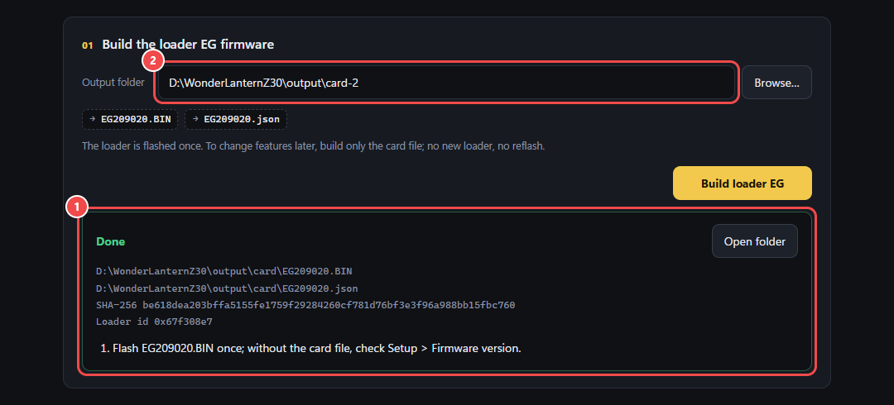

- `EG209020.BIN` is the loader firmware to flash; `EG209020.json` records the loader's identity and capabilities.
- The **SHA-256** matches the loader SHA-256 on the Release page; the programs for all three systems build this same file.
- **Open folder** opens the output folder.
- The output folder above moves on to the next empty folder (②), and the card file's **Output folder** below points at `card`.

### Flash the camera

1. Copy `EG209020.BIN` to the **root** of the memory card (no `Z30` folder on the card yet).
2. With a charged battery, insert the card, open **Setup menu → Firmware version** and follow the prompts. Do not switch off or remove the card while updating.
3. After the restart, check that:
   - menus, photo and video behave as stock;
   - **Setup menu → Firmware version** opens and shows two extra lines (project name and copyright) under the version.
4. You can delete `EG209020.BIN` from the card root afterwards.

This is done once. Changing features or updating needs no reflash unless the program says the loader must be updated.

## 5. Build the feature card file

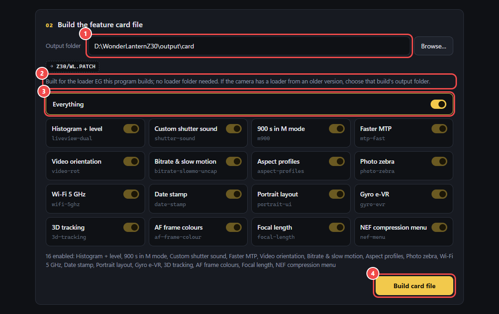

1. **Output folder** (①) is where `Z30\WL.PATCH` goes; any empty folder will do and building the loader first is **not** needed. It defaults to the newest loader folder under `output` without a card file, otherwise to a new empty folder.
2. The note under it (②) says which loader the card file is built for:
   - **"Built for the loader EG this program builds"**: the folder has no loader EG. A given program version always builds the same loader, so the card file works on a camera flashed with the loader from this program version.
   - **"Built for the loader EG in this folder"**: the folder holds `EG209020.BIN` and `EG209020.json`; see [the camera has an older loader](#the-camera-has-an-older-loader) below.
3. **Everything** (③) is on by default and includes all seventeen features.
4. Click **Build card file** (④).

### Picking features

Switch **Everything** off and turn on what you want (①). Hover a feature for its description; the summary (②) lists what will actually be enabled, including the menu framework some features bring along.

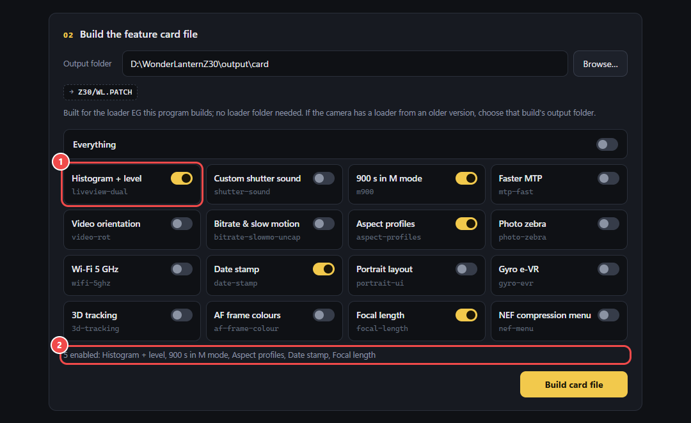

The features are described in the [README feature list](../README.en.md).

### Done

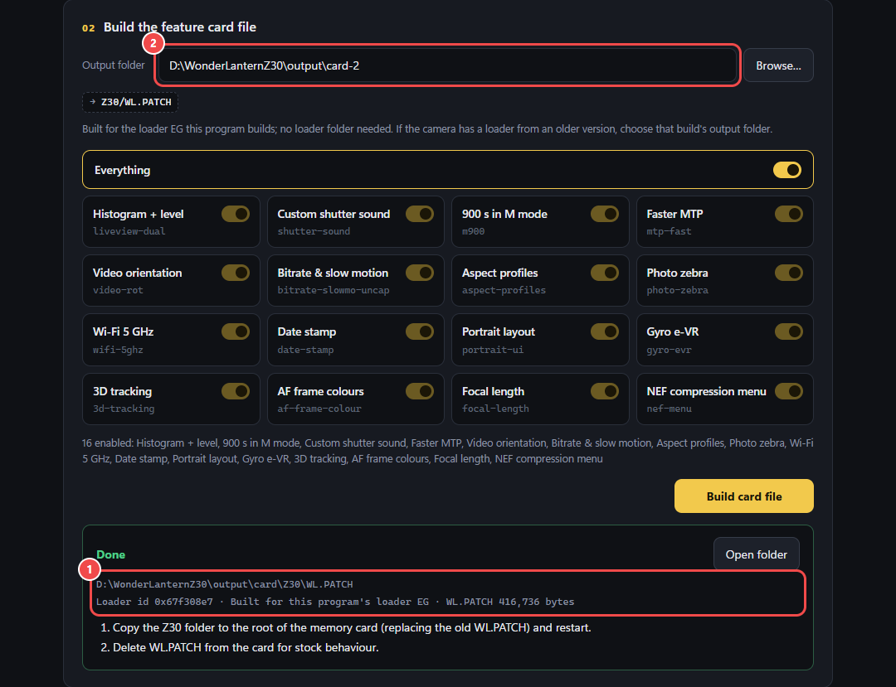

- The **Loader id** in the result (①) must match the one from step 4: a card file only loads on that loader. The line also says which loader it was built for.
- After a build for this program's loader, the output folder (②) moves on to the next empty folder, ready for a card file with other features.

### Copy to the memory card

Click **Open folder** and copy the whole `Z30` folder to the root of the memory card:

```text
card root\
└─ Z30\
   └─ WL.PATCH
```

Start the camera: about 3 seconds later the features appear and photo live view briefly shows **"Wonder Lantern ready · N features"**. The features are in the **eighth tab** on the left of the menu (lantern icon); its first row, Status, shows whether the card file loaded, its version and the feature count. When none of the chosen features has a menu page, the tab holds only Status.

The loader writes `Z30\WL.LOG`; a line starting with `WL.PATCH S=01` means success, the other codes are in the [SD card loader notes](card-loader.md) (Chinese).

## 6. Changing features or updating later

1. Start the program, pick features and click **Build card file**: no loader build. The output folder is already a new empty one.
2. Replace `Z30\WL.PATCH` on the card with the new one and restart.

No reflash is needed.

### The camera has an older loader

With a **newer** program whose loader differs from the one on the camera (another loader id), build the card file for the loader on the camera: set **Output folder** to the folder that loader was built in (it holds `EG209020.BIN` and `EG209020.json`). The note (②) changes to "Built for the loader EG in this folder":

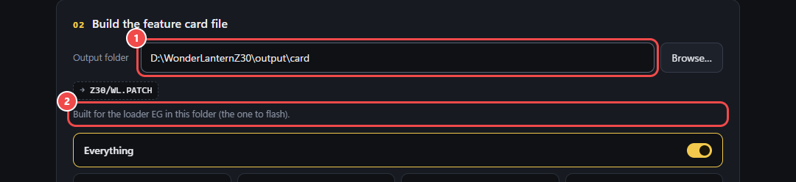

The program never overwrites: move the old `Z30\WL.PATCH` out of that folder first. Only when a new card file needs something the old loader lacks does the program refuse and ask for a loader update; then repeat step 4.

A card file made for another loader is refused by the loader on the camera: the camera stays stock and `Z30\WL.LOG` records why. Replace it with a card file built for the right loader.

## Back to stock

- **For now:** delete `Z30\WL.PATCH` from the card (or use a card without it) and restart. No reflash.
- **Completely:** copy the stock `Z_30_0120.bin` to the card root and flash it through **Setup menu → Firmware version**.

## Common problems

| Message or symptom | Cause and fix |
| --- | --- |
| "Does not match" | Not an unmodified Z30 C 1.20 firmware; download it again and compare size and SHA-256 |
| "File not found" | Wrong path; choose the file with Browse… |
| "only one of EG209020.BIN and EG209020.json" | The loader in the output folder is incomplete; keep both files together or choose another folder |
| "Already exists and will not be overwritten" | Choose an empty folder or move the old `Z30\WL.PATCH` away; for a loader, use a new folder |
| The program asks for a loader update | Build a loader in a new folder, flash it, then build the card file |
| Features do not appear | No `Z30\WL.LOG` on the card means `Z30\WL.PATCH` was not found (check folder name and place); otherwise look up its code in the [SD card loader notes](card-loader.md). For a loader id mismatch see section 6 |
| Windows: nothing happens or it closes at once | Extract the whole archive; make sure the WebView2 runtime is installed |
| macOS: "cannot be opened" or "is damaged" | The program is not signed; right-click → Open as in section 1.3, or remove the quarantine attribute |
| Linux: `libnss3.so` or another library not found | Install NSS (`libnss3`) with your package manager; starting the program from a terminal shows what is missing |

For the command line and running from source, see the [README](../README.en.md#quick-start) and the [offline build guide](../PATCH_GUIDE.md) (Chinese).
