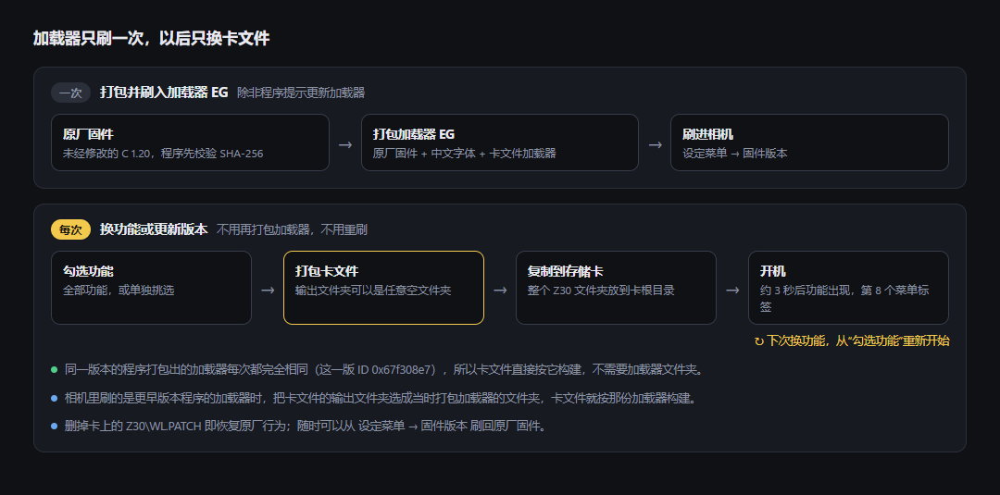
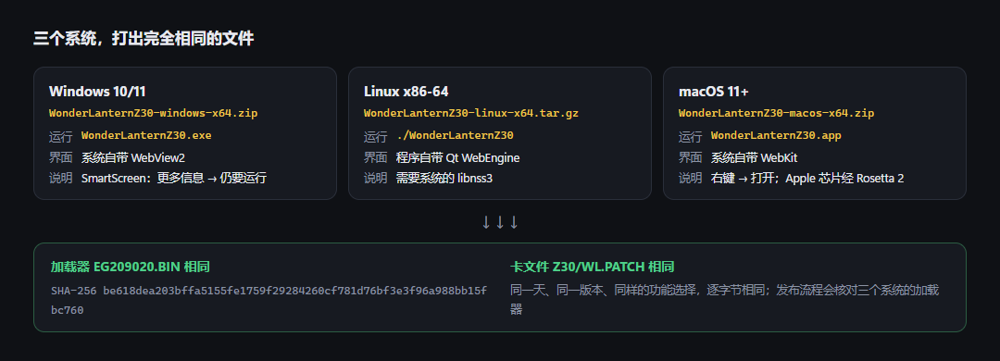
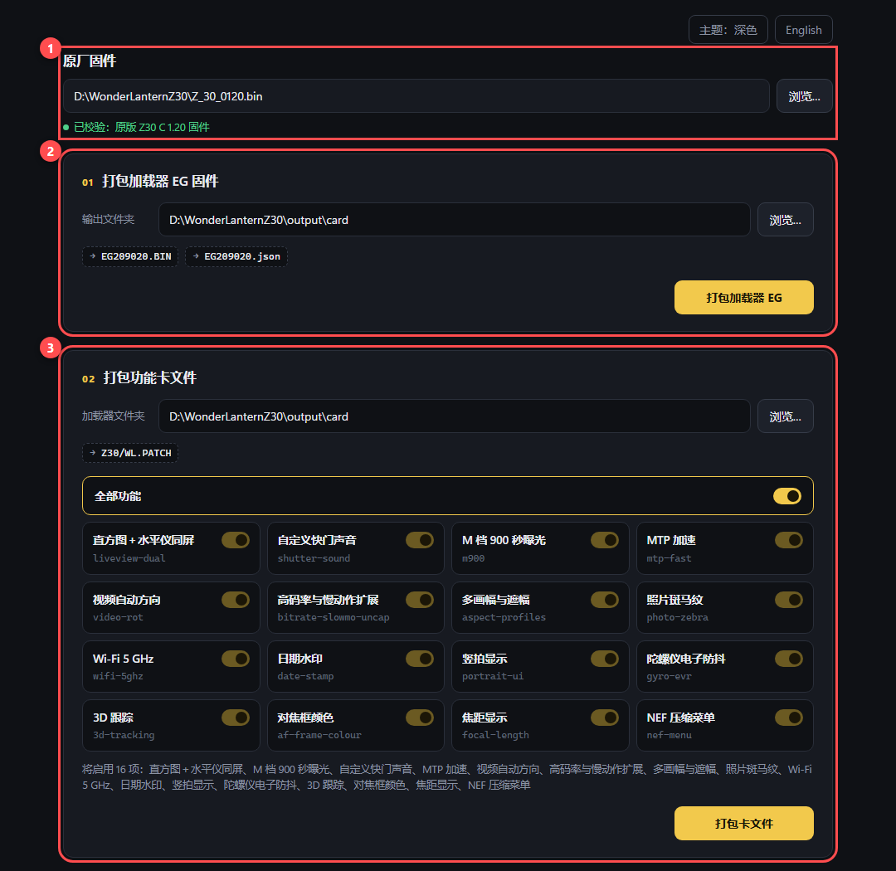
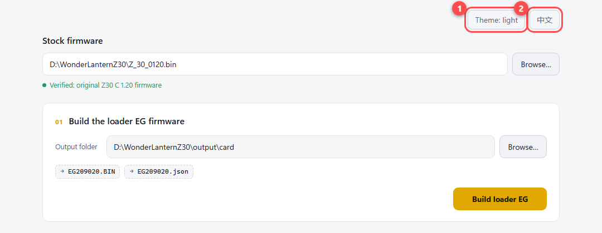
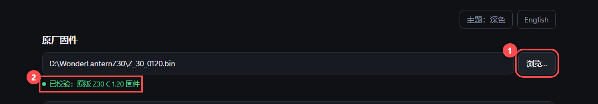
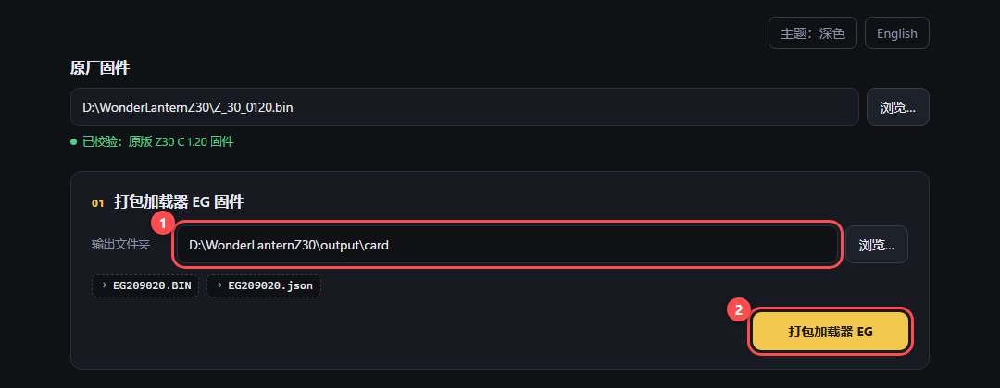
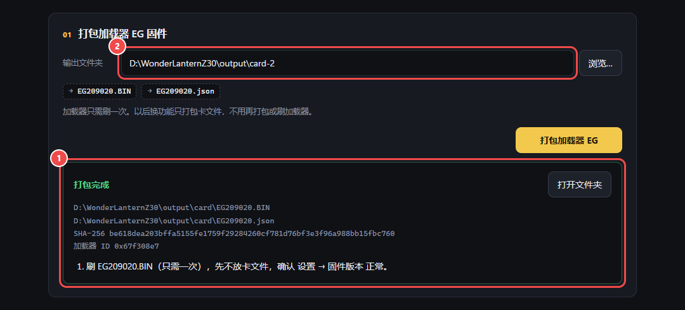
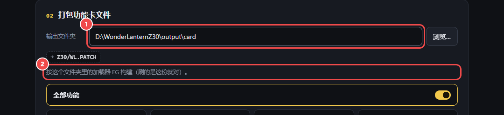

# 图形界面打包教程

**简体中文** · [English](gui-tutorial.en.md)

这篇教程一步步演示如何用图形界面程序 `WonderLanternZ30` 打包**加载器固件**和**功能卡文件**，并装进 Nikon Z30。程序有 Windows、Linux 和 macOS 三个版本，界面完全相同，全程不需要安装 Python，也不需要命令行。

> [!NOTE]
> 截图里的路径 `D:\WonderLanternZ30\…` 只是示例，你的电脑上会显示程序实际所在的文件夹。界面跟随系统语言显示中文或英文，下面以中文深色主题为例。截图由 `tools/make_gui_screenshots.py` 从程序的真实界面生成。

> [!WARNING]
> 修改固件有风险。开始前请保留一份未经修改的 `Z_30_0120.bin`，并确认自己知道如何通过 **设定菜单 → 固件版本** 升级固件——只要这个页面能进入，就能刷回原厂固件。

> [!TIP]
> 打包程序顶部还内置了 **「快门音频」** 独立标签页，可以把任意 MP3 / WAV / M4A 裁剪试听并一键导出为相机标准快门声，详细图文步骤见 **[自定义快门声音制作与使用教程](shutter-sound-tutorial.md)**。

## 整体流程



| 步骤 | 做什么 | 频率 |
| --- | --- | --- |
| 1 | 下载程序、准备原厂固件 | 一次 |
| 2 | 打包**加载器 EG**（`EG209020.BIN`），刷进相机 | 一次（除非程序提示更新加载器） |
| 3 | 打包**功能卡文件**（`Z30/WL.PATCH`），复制到存储卡 | 每次换功能或更新版本；**不需要**再打包加载器 |

打包程序只在电脑上生成文件：它不连接相机，也不写 SD 卡，复制和刷机都由你自己完成。

## 1. 下载程序、准备原厂固件

### 1.1 按系统下载

打开 [Releases 页面](https://github.com/WonderLantern/wonder-lantern-z30/releases/latest)，按系统下载一个压缩包。三个版本打包出的加载器和卡文件逐字节相同，发布流程会核对这一点：



| 系统 | 下载 | 解压后运行 |
| --- | --- | --- |
| Windows 10/11 | `WonderLanternZ30-windows-x64.zip` | `WonderLanternZ30\WonderLanternZ30.exe` |
| Linux x86-64 | `WonderLanternZ30-linux-x64.tar.gz` | `WonderLanternZ30/WonderLanternZ30` |
| macOS 11 及以上（Apple 芯片） | `WonderLanternZ30-macos-arm64.zip` | `WonderLanternZ30/WonderLanternZ30.app` |

可以先核对 Release 页面列出的压缩包 SHA-256。**完整解压**后再运行，不要在压缩包里直接双击，程序需要旁边的其他文件。

### 1.2 放入原厂固件

准备尼康官方的 Z30 C 1.20 固件 `Z_30_0120.bin`，放进解压出的 `WonderLanternZ30` 文件夹（和程序放在一起），程序启动时会自动找到它。

| 项目 | 值 |
| --- | --- |
| 文件 | `Z_30_0120.bin`，34,496,798 字节 |
| SHA-256 | `1a5449ef505f1f347ed4e066a6a3f588ea542240680e83f4ebcae3b16da3434a` |

**Windows / Linux：**

```text
WonderLanternZ30\
├─ WonderLanternZ30.exe    ← Linux 上是 WonderLanternZ30（没有 .exe）
├─ _internal\              ← 程序自带的运行库，不要删
├─ licenses\               ← 许可证
└─ Z_30_0120.bin           ← 你自己放进来的原厂固件
```

**macOS：**

```text
WonderLanternZ30/
├─ WonderLanternZ30.app
├─ licenses/
└─ Z_30_0120.bin           ← 和 .app 放在同一个文件夹
```

打包结果写到同一个文件夹里的 `output`。macOS 上如果这个文件夹不能写入（例如直接在“下载”的隔离状态下运行），程序改用 `~/WonderLanternZ30/output`，固件也可以放在 `~/WonderLanternZ30`。

### 1.3 第一次运行

程序没有代码签名，各系统第一次运行时需要放行一次：

| 系统 | 怎么做 |
| --- | --- |
| Windows | SmartScreen 提示“已保护你的电脑”时，点“更多信息 → 仍要运行”。界面由 Windows 10/11 自带的 Microsoft Edge WebView2 运行时显示 |
| macOS | 在 Finder 里**右键 `WonderLanternZ30.app` → 打开**，弹窗里再点“打开”；或在终端运行 `xattr -dr com.apple.quarantine WonderLanternZ30.app` |
| Linux | 在终端运行 `tar -xzf WonderLanternZ30-linux-x64.tar.gz`，再运行 `./WonderLanternZ30/WonderLanternZ30`，以后也可以在文件管理器里双击。界面由程序自带的 Qt WebEngine 显示，只需要系统装有 NSS 库（`libnss3`，装了 Firefox 或 Chrome 的桌面一般都有；Ubuntu/Debian 上是 `sudo apt install libnss3`） |

## 2. 认识界面

打开程序，窗口从上到下分为三块：



1. **原厂固件**：选择 `Z_30_0120.bin`，下方显示校验结果。
2. **01 打包加载器 EG 固件**：生成刷进相机的 `EG209020.BIN`，**只需做一次**。
3. **02 打包功能卡文件**：勾选功能，生成放在存储卡上的 `Z30/WL.PATCH`。以后换功能只用这一块。

右上角的两个按钮分别切换主题（①，跟随系统 / 浅色 / 深色）和界面语言（②）：



## 3. 校验原厂固件

如果 `Z_30_0120.bin` 就在程序旁边，路径会自动填好并开始校验。否则点 **浏览…**（①）手动选择，或者把完整路径粘贴进输入框。



看到绿色的 **“已校验：原版 Z30 C 1.20 固件”**（②）才能继续。如果显示红色的“文件不匹配”（①），说明文件被改过、下载不完整或版本不对，请重新从尼康官网下载 C 1.20 固件：


## 4. 打包加载器 EG（只需一次）

加载器固件 = 原厂固件 + 补全常用字的中文字体 + 一个读取存储卡补丁的加载器。不插卡文件时，相机行为和原厂一致。

> [!TIP]
> 已经刷过**这个版本**程序打包的加载器？直接跳到第 5 步。



1. **输出文件夹**（①）默认是程序旁边的 `output\card`，一般不用改。程序不会覆盖已有文件，所以每次会自动换一个新文件夹（`card`、`card-2`……）。
2. 下方的提示（②）说明加载器只需刷一次。
3. 点 **打包加载器 EG**（③），按钮显示“正在打包…”，等待约几十秒到几分钟。

完成后下方出现绿色的 **“打包完成”**（①）：



- 结果里列出 `EG209020.BIN`（要刷进相机的加载器固件）和 `EG209020.json`（加载器的身份和能力）。
- **SHA-256** 与 Release 页面公布的加载器 SHA-256 一致，可以用来核对；三个系统的程序打包出的都是这一份。
- 点 **打开文件夹** 可以直接打开输出位置。
- 上方的输出文件夹自动换成下一个空文件夹（②），下方卡文件的“输出文件夹”自动指向刚才的 `card`。

### 刷入相机

1. 把 `EG209020.BIN` 复制到存储卡**根目录**（卡上**先不要**放 `Z30` 文件夹）。
2. 电池充满电，插卡开机，进入 **设定菜单 → 固件版本**，按屏幕提示升级。升级过程中不要关机、不要拔卡。
3. 升级完成后重启，确认：
   - 菜单、拍照、录像和原厂一样；
   - **设定菜单 → 固件版本** 能正常进入，版本下方多出项目名和版权两行。
4. 刷完后可以删掉卡根目录的 `EG209020.BIN`。

这一步只需做一次。以后换功能、更新版本都不用再刷机，除非打包程序明确提示需要更新加载器。

## 5. 打包功能卡文件


1. **输出文件夹**（①）是 `Z30\WL.PATCH` 写入的位置，选一个空文件夹即可，**不需要**先打包加载器。默认是 `output` 下最新的、还没有卡文件的加载器文件夹，没有则是一个新的空文件夹。
2. 输入框下方的提示（②）说明卡文件按哪份加载器构建：
   - **“按本程序打包出的加载器 EG 构建”**——文件夹里没有加载器 EG。同一版本的程序打包出的加载器每次都完全相同，所以只要相机里刷的是这个版本程序打包的加载器，卡文件就能直接用。
   - **“按这个文件夹里的加载器 EG 构建”**——文件夹里有 `EG209020.BIN` 和 `EG209020.json`，见下面的[“相机里是旧版本的加载器”](#相机里是旧版本的加载器)。
3. **全部功能**（③）默认打开，包含全部十七项功能。
4. 点 **打包卡文件**（④）。

### 只选部分功能

关掉“全部功能”后，可以单独打开需要的功能（①）。鼠标停在某个功能上会显示详细说明；下方的摘要（②）列出实际会启用的功能——有些功能会自动带上它依赖的扩展菜单框架。


各功能的说明见 [README 的功能一览](../README.md#功能一览)。

### 打包完成


- 结果（①）里的 **加载器 ID** 应该和第 4 步打包加载器时的一致——卡文件只能被这份加载器加载。后面注明了按哪份加载器构建。
- 按本程序的加载器构建后，输出文件夹（②）自动换成下一个空文件夹，可以直接再打包一份不同功能的卡文件。

### 复制到存储卡

点 **打开文件夹**，把里面的整个 `Z30` 文件夹复制到存储卡根目录：

```text
存储卡根目录\
└─ Z30\
   └─ WL.PATCH
```

插卡开机，约 3 秒后功能出现，照片取景上方会短暂显示 **“Wonder Lantern 已就绪 · N 项功能”**。新功能在菜单左侧的**第 8 个标签**（灯笼图标），第一行“状态”页显示卡文件是否加载、版本和功能数。所选功能都没有菜单页时，这个标签里只有“状态”页。

加载器会在卡上写入 `Z30\WL.LOG`，内容以 `WL.PATCH S=01` 开头表示加载成功；其他代码的含义见 [SD 卡加载说明](card-loader.md)。

## 6. 以后换功能或更新版本

1. 打开程序，重新勾选功能，直接点 **打包卡文件**——不用再打包加载器，输出文件夹默认就是一个新的空文件夹。
2. 用新的 `Z30\WL.PATCH` 替换卡上的旧文件，重启相机。

不需要重新刷机。

### 相机里是旧版本的加载器

换了**新版**程序，而它的加载器和相机里那份不同时（加载器 ID 不同），卡文件要按相机里那份加载器构建：把**输出文件夹**选成当时打包加载器的文件夹（里面有 `EG209020.BIN` 和 `EG209020.json`）。提示（②）会变成“按这个文件夹里的加载器 EG 构建”：



程序不会覆盖已有文件，先把那个文件夹里旧的 `Z30\WL.PATCH` 移走。只有新版卡文件用到旧加载器不具备的能力时，程序才会拒绝打包并提示更新加载器，这时重复第 4 步，把新的加载器刷进相机。

如果卡文件和相机里的加载器对不上，加载器会拒绝加载它，相机保持原厂行为，`Z30\WL.LOG` 会记下原因——换一个按正确加载器打包的卡文件即可。

## 恢复原厂行为

- **临时恢复：** 删掉卡上的 `Z30\WL.PATCH`，或换一张没有这个文件的卡，重启即可。不需要重刷。
- **完全恢复：** 把原厂 `Z_30_0120.bin` 复制到卡根目录，通过 **设定菜单 → 固件版本** 刷回。

## 常见问题

| 现象 | 原因与处理 |
| --- | --- |
| 原厂固件显示“文件不匹配” | 不是未经修改的 Z30 C 1.20 固件。重新从尼康官网下载，核对大小和 SHA-256 |
| 原厂固件显示“找不到该文件” | 路径写错了，点“浏览…”重新选择 |
| “只有 EG209020.BIN 和 EG209020.json 之一” | 输出文件夹里的加载器不完整。把两个文件放在一起，或换一个文件夹 |
| “文件已存在，程序不会覆盖” | 文件夹里已经有同名输出。打包卡文件时换一个空文件夹，或先移走旧的 `Z30\WL.PATCH`；打包加载器时换一个新文件夹 |
| 程序提示需要更新加载器 | 新卡文件需要新版加载器。换一个新文件夹重新打包加载器并刷入，再打包卡文件 |
| 插卡后功能没有出现 | 看卡上有没有 `Z30\WL.LOG`：没有说明加载器没找到 `Z30\WL.PATCH`（检查文件夹名和位置）；有则按其中的代码查 [SD 卡加载说明](card-loader.md)。加载器 ID 对不上时见第 6 节 |
| Windows：双击没反应或闪退 | 确认已完整解压，系统装有 Microsoft Edge WebView2 运行时 |
| macOS：提示“无法打开”或“已损坏” | 程序没有签名，按第 1.3 节右键 → 打开，或去掉隔离属性 |
| Linux：启动报 `libnss3.so` 等找不到 | 用包管理器装上 NSS（`libnss3`）。在终端运行程序可以看到缺少哪个库 |

更多细节（命令行打包、从源码运行）见 [离线构建指引](../PATCH_GUIDE.md)。
