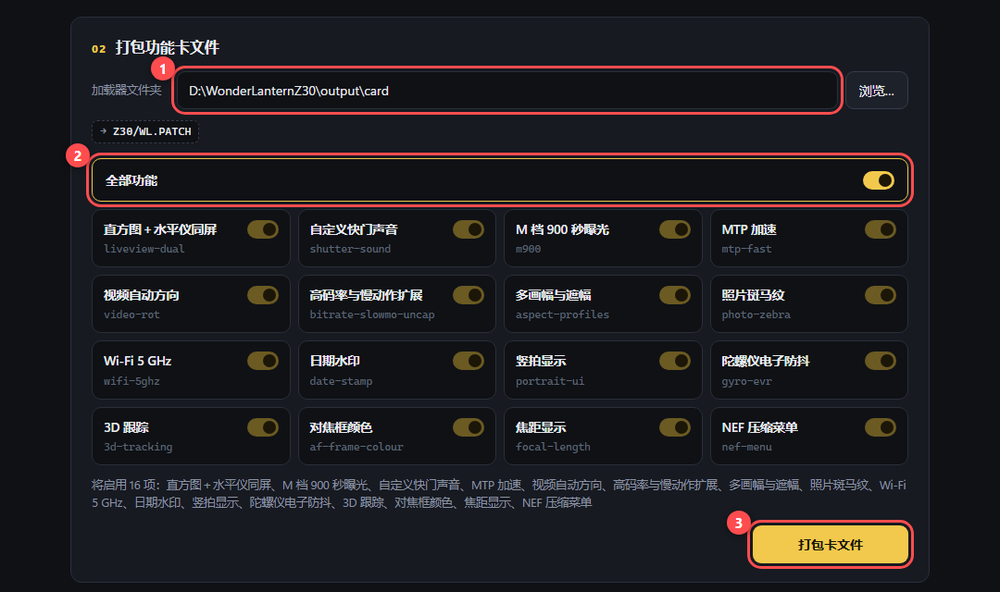
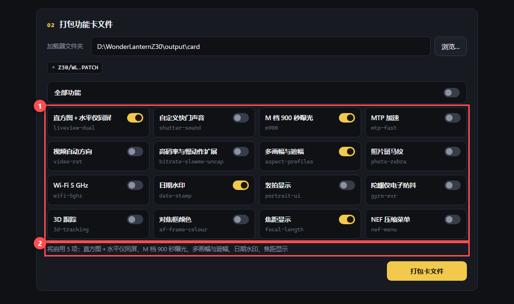
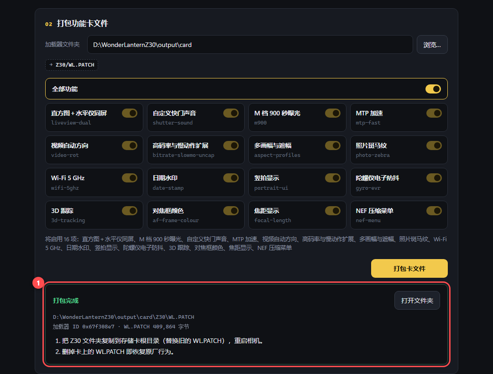
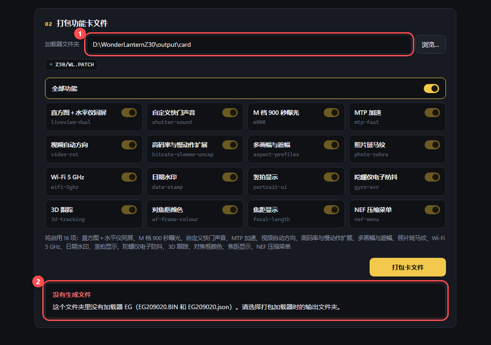

# 图形界面打包教程

**简体中文** · [English](gui-tutorial.en.md)

这篇教程一步步演示如何用 Windows 图形界面程序 `WonderLanternZ30.exe` 打包**加载器固件**和**功能卡文件**，并装进 Nikon Z30。全程不需要安装 Python，也不需要命令行。

> [!NOTE]
> 截图里的路径 `D:\WonderLanternZ30\…` 只是示例，你的电脑上会显示程序实际所在的文件夹。界面跟随系统语言显示中文或英文，下面以中文深色主题为例。

> [!WARNING]
> 修改固件有风险。开始前请保留一份未经修改的 `Z_30_0120.bin`，并确认自己知道如何通过 **设定菜单 → 固件版本** 升级固件——只要这个页面能进入，就能刷回原厂固件。

## 整体流程

| 步骤 | 做什么 | 频率 |
| --- | --- | --- |
| 1 | 下载程序、准备原厂固件 | 一次 |
| 2 | 打包**加载器 EG**（`EG209020.BIN`），刷进相机 | 一次（除非程序提示更新加载器） |
| 3 | 打包**功能卡文件**（`Z30/WL.PATCH`），复制到存储卡 | 每次换功能或更新版本 |

打包程序只在电脑上生成文件：它不连接相机，也不写 SD 卡，复制和刷机都由你自己完成。

## 1. 下载程序、准备原厂固件

1. 打开 [Releases 页面](https://github.com/WonderLantern/wonder-lantern-z30/releases/latest)，下载 `WonderLanternZ30-windows-x64.zip`。
2. **完整解压**到一个文件夹（例如 `D:\WonderLanternZ30`）。不要在压缩包里直接双击运行，程序需要旁边的其他文件。
3. 准备尼康官方的 Z30 C 1.20 固件 `Z_30_0120.bin`，放进解压后的文件夹（和 `WonderLanternZ30.exe` 放在一起），程序启动时会自动找到它。

| 项目 | 值 |
| --- | --- |
| 文件 | `Z_30_0120.bin`，34,496,798 字节 |
| SHA-256 | `1a5449ef505f1f347ed4e066a6a3f588ea542240680e83f4ebcae3b16da3434a` |

解压后的文件夹大致是这样：

```text
D:\WonderLanternZ30\
├─ WonderLanternZ30.exe
├─ _internal\            ← 程序自带的运行库，不要删
├─ licenses\             ← 许可证
└─ Z_30_0120.bin         ← 你自己放进来的原厂固件
```

> [!TIP]
> 程序没有代码签名，第一次运行时 Windows SmartScreen 可能提示“已保护你的电脑”。可以先核对 Release 页面列出的 zip 的 SHA-256，确认无误后点“更多信息 → 仍要运行”。程序需要 Windows 10/11 自带的 Microsoft Edge WebView2 运行时。

## 2. 认识界面

双击 `WonderLanternZ30.exe`，窗口从上到下分为三块：


1. **原厂固件**：选择 `Z_30_0120.bin`，下方显示校验结果。
2. **01 打包加载器 EG 固件**：生成刷进相机的 `EG209020.BIN`，只需做一次。
3. **02 打包功能卡文件**：勾选功能，生成放在存储卡上的 `Z30/WL.PATCH`。

右上角的两个按钮可以切换主题（跟随系统 / 浅色 / 深色）和界面语言：


## 3. 校验原厂固件

如果 `Z_30_0120.bin` 就在程序旁边，路径会自动填好并开始校验。否则点 **浏览…**（①）手动选择，或者把完整路径粘贴进输入框。


看到绿色的 **“已校验：原版 Z30 C 1.20 固件”**（②）才能继续。如果显示红色的“文件不匹配”，说明文件被改过、下载不完整或版本不对，请重新从尼康官网下载 C 1.20 固件：


## 4. 打包加载器 EG（只需一次）

加载器固件 = 原厂固件 + 补全常用字的中文字体 + 一个读取存储卡补丁的加载器。不插卡文件时，相机行为和原厂一致。


1. **输出文件夹**（①）默认是程序旁边的 `output\card`，一般不用改。程序不会覆盖已有文件，所以每次会自动换一个新文件夹（`card`、`card-2`……）。
2. 点 **打包加载器 EG**（②），按钮显示“正在打包…”，等待约几十秒到几分钟。

完成后下方出现绿色的 **“打包完成”**：


- 结果里列出 `EG209020.BIN`（要刷进相机的加载器固件）和 `EG209020.json`（加载器的身份和能力，以后打包卡文件要用）。**两个文件请一起保留在这个文件夹里。**
- **SHA-256** 与 Release 页面公布的加载器 SHA-256 一致，可以用来核对。
- 点 **打开文件夹** 可以直接打开输出位置。
- 打包完成后，上方的输出文件夹会自动换成下一个空文件夹（如 `card-2`），下方“加载器文件夹”自动指向刚才的 `card`。

### 刷入相机

1. 把 `EG209020.BIN` 复制到存储卡**根目录**（卡上**先不要**放 `Z30` 文件夹）。
2. 电池充满电，插卡开机，进入 **设定菜单 → 固件版本**，按屏幕提示升级。升级过程中不要关机、不要拔卡。
3. 升级完成后重启，确认：
   - 菜单、拍照、录像和原厂一样；
   - **设定菜单 → 固件版本** 能正常进入，版本下方多出项目名和版权两行。
4. 刷完后可以删掉卡根目录的 `EG209020.BIN`。

这一步只需做一次。以后换功能、更新版本都不用再刷机，除非打包程序明确提示需要更新加载器。

## 5. 打包功能卡文件



1. **加载器文件夹**（①）必须指向**刷进相机的那份** `EG209020.BIN` 所在的文件夹。刚打包完加载器时它会自动填好；以后重新打开程序，它默认指向 `output` 下最新的加载器文件夹。如果你刷的是更早的一份，点“浏览…”改过来。
2. **全部功能**（②）默认打开，包含全部十六项功能。
3. 点 **打包卡文件**（③）。

### 只选部分功能

关掉“全部功能”后，可以单独打开需要的功能。鼠标停在某个功能上会显示详细说明；下方的摘要（②）列出实际会启用的功能——有些功能会自动带上它依赖的扩展菜单框架。



各功能的说明见 [README 的功能一览](../README.md#功能一览)。

### 打包完成



结果里的 **加载器 ID** 应该和第 4 步打包加载器时的一致——卡文件只能被这份加载器加载。

### 复制到存储卡

点 **打开文件夹**，把里面的整个 `Z30` 文件夹复制到存储卡根目录：

```text
存储卡根目录\
└─ Z30\
   └─ WL.PATCH
```

插卡开机，约 3 秒后功能出现，照片取景上方会短暂显示 **“Wonder Lantern 已就绪 · N 项功能”**。新功能在 **设定菜单 → 自定义菜单**，第一行“状态”页显示卡文件是否加载、版本和功能数。

加载器会在卡上写入 `Z30\WL.LOG`，内容以 `WL.PATCH S=01` 开头表示加载成功；其他代码的含义见 [SD 卡加载说明](card-loader.md)。

## 6. 以后换功能或更新版本

1. 用新版程序（或同一个程序）打开，**加载器文件夹**选刷进相机的那份。
2. 程序不会覆盖已有文件：先把这个文件夹里旧的 `Z30\WL.PATCH` 移走或删掉。
3. 重新勾选功能，点 **打包卡文件**，用新的 `Z30\WL.PATCH` 替换卡上的旧文件，重启相机。

不需要重新刷机。只有新版卡文件用到旧加载器不具备的能力时，程序才会拒绝打包并提示更新加载器，这时重复第 4 步，把新的加载器刷进相机。

## 恢复原厂行为

- **临时恢复：** 删掉卡上的 `Z30\WL.PATCH`，或换一张没有这个文件的卡，重启即可。不需要重刷。
- **完全恢复：** 把原厂 `Z_30_0120.bin` 复制到卡根目录，通过 **设定菜单 → 固件版本** 刷回。

## 常见问题

| 现象 | 原因与处理 |
| --- | --- |
| 原厂固件显示“文件不匹配” | 不是未经修改的 Z30 C 1.20 固件。重新从尼康官网下载，核对大小和 SHA-256 |
| 原厂固件显示“找不到该文件” | 路径写错了，点“浏览…”重新选择 |
| “这个文件夹里没有加载器 EG” | “加载器文件夹”没有指向含 `EG209020.BIN` 和 `EG209020.json` 的文件夹，改成打包加载器时的输出文件夹（见下图） |
| “文件已存在，程序不会覆盖” | 文件夹里已经有同名输出。打包卡文件时先移走旧的 `Z30\WL.PATCH`；打包加载器时换一个新文件夹 |
| 程序提示需要更新加载器 | 新卡文件需要新版加载器。换一个新文件夹重新打包加载器并刷入，再打包卡文件 |
| 插卡后功能没有出现 | 看卡上有没有 `Z30\WL.LOG`：没有说明加载器没找到 `Z30\WL.PATCH`（检查文件夹名和位置）；有则按其中的代码查 [SD 卡加载说明](card-loader.md) |
| 双击程序没反应或闪退 | 确认已完整解压，并且系统装有 Microsoft Edge WebView2 运行时 |



更多细节（命令行打包、macOS / Linux 运行方式）见 [离线构建指引](../PATCH_GUIDE.md)。
