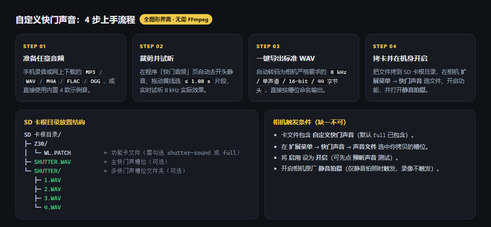
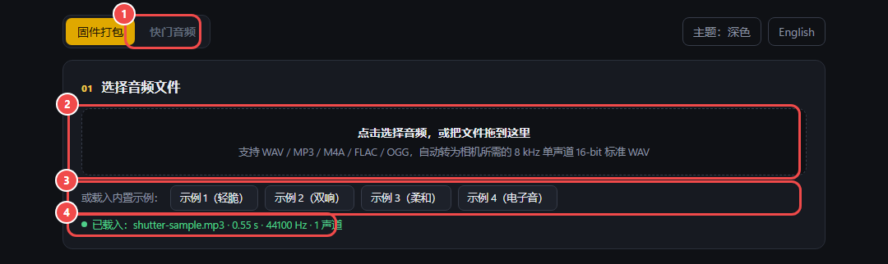
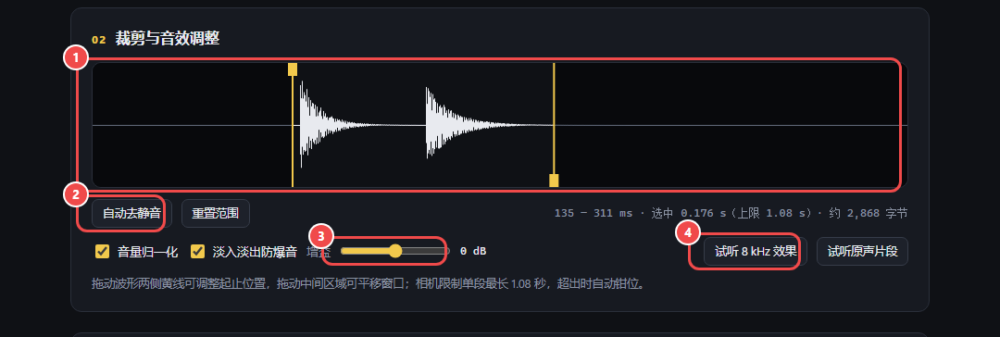
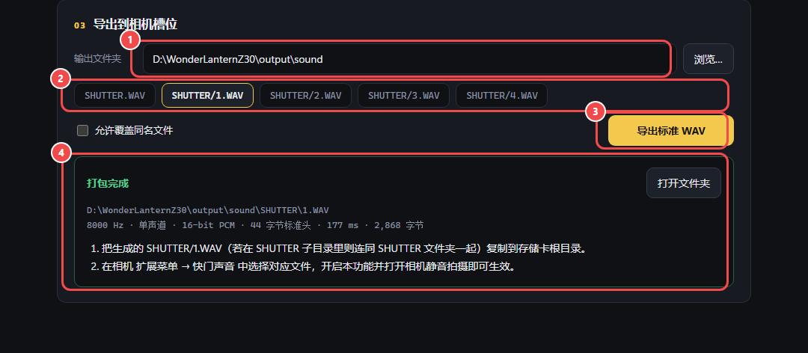

# 自定义快门声音制作与使用教程（图文）

这篇教程一步步演示如何把任意音频（`MP3` / `WAV` / `M4A` / `FLAC` / `OGG`）转换成 Nikon Z30 可直接播放的**标准快门声 WAV**，并放到 SD 卡上在机身启用。

全程在图形界面打包程序 `WonderLanternZ30` 内完成，**不需要安装 Python、Audacity 或 FFmpeg**，Windows / macOS / Linux 界面完全一致。

> [!NOTE]
> 使用本功能前，相机需已安装加载器固件，且存储卡上的 `Z30/WL.PATCH` 包含 `shutter-sound`（默认的 `full` 预设已包含）。还没刷加载器或打卡文件？先看 [图形界面打包教程](gui-tutorial.md)。

## 整体流程



| 步骤 | 做什么 | 说明 |
| --- | --- | --- |
| 1 | 准备音频 | 任意常见音频格式，或直接使用程序内置的 4 款示例快门声 |
| 2 | 裁剪并试听 | 在程序「快门音频」页自动去开头静音、框选 `≤ 1.08 秒` 片段，提前试听 8 kHz 实际效果 |
| 3 | 导出标准 WAV | 自动转成相机要求的 `8000 Hz · 单声道 · 16-bit PCM · 44 字节头`，按槽位命名保存 |
| 4 | 拷卡并开启 | 复制到 SD 卡根目录，在相机 **扩展菜单 → 快门声音** 选择并开启，再打开**静音拍摄** |

---

## 1. 切换到「快门音频」并载入音频

打开 `WonderLanternZ30`（Windows 是 `WonderLanternZ30.exe`，macOS 是 `WonderLanternZ30.app`，源码环境也可运行 `python patch_gui.py`）：



1. 点击窗口左上角的 **快门音频**（①）标签页。
2. 点击虚线框（②）选择音频文件，或直接把音频文件从文件管理器拖进虚线框内。支持 **WAV、MP3、M4A、AAC、FLAC、OGG、OPUS** 等常见格式。
3. 手头暂时没有素材？也可以直接点下方的 **内置示例 1–4**（③）体验：
   - **示例 1（轻脆）**：偏干脆的单次机械快门声
   - **示例 2（双响）**：带二次回弹的双击快门声
   - **示例 3（柔和）**：音量更轻、偏柔和的快门声
   - **示例 4（电子音）**：短促清脆的电子提示音
4. 载入成功后，下方状态栏（④）会变绿，显示文件名、原始时长、采样率和声道数。

---

## 2. 裁剪波形、调整音量与 8 kHz 试听

Nikon Z30 固件对快门声有严格限制：**最长 1.08 秒**，而且如果素材开头有一段空白静音，拍照时就会感觉“按下快门延迟半拍才响”。程序会在载入音频时自动帮你裁掉开头和结尾的静音。



1. **交互裁剪波形（①）**：
   - 拖动左右两侧的**黄色竖线与手柄**可精确调整起止时间；
   - 拖动中间高亮选区可**整体平移**时间窗口；
   - 如果选区超过 1.08 秒，程序会自动钳位到 1.08 秒以内；右下角实时显示起止毫秒数、选中时长和预计文件字节数。
2. **快捷按钮（②）**：
   - **自动去静音**：自动定位有效声音起止点（保留约 5 ms 起始缓冲与 25 ms 尾音），非常适合网上下载的快门音效。
   - **重置范围**：恢复从 `0 ms` 开始的完整范围（超过 1.08 秒则取前 1.08 秒）。
3. **音量与防爆音处理（③）**：
   - **音量归一化**（默认开启）：自动把峰值拉升到 `-1 dBFS`，解决原素材声音偏小的问题。
   - **淡入淡出防爆音**（默认开启）：在首尾加极短淡入（2 ms）与淡出（5 ms），防止截断处产生“咔哒”电流爆音。
   - **增益滑块**（`-12 dB` 至 `+12 dB`）：微调最终响度；如果调得过高导致削波，状态栏会出现红色提示，稍微往左拉回即可。
4. **试听对比（④）**：
   - **试听 8 kHz 效果**：按相机实际播放的 8000 Hz 单声道 16-bit 规格实时重采样并播放，**听到什么，相机里基本就是什么**。
   - **试听原声片段**：播放原始未降采样的选区，方便对比音色变化。

> [!TIP]
> **调出清脆快门声的小技巧：**
> - 尽量把左边的黄色起点紧贴波形真正起跳的位置（`自动去静音` 通常已经很准），拍照手感最跟手。
> - 8 kHz 采样率的最高还原频率是 4 kHz，本身带明显中频“咔嗒”声的机械快门素材（如单反/胶片机/旁轴快门声）在机身小扬声器上效果最好；纯高频细碎声降采样后会偏闷。
> - 时长控制在 **0.12 – 0.35 秒** 左右体验最自然，连拍时也不易拖沓。

---

## 3. 导出为相机标准 WAV

满意后，在最下方 **03 导出到相机槽位** 卡片中保存文件：



1. **输出文件夹（①）**：默认是程序旁边的 `output\sound`，也可以点 **浏览…** 改成你的 `output\card` 或任意本地目录。程序不会直接写 SD 卡。
2. **选择相机槽位（②）**：相机一共支持 5 个预设槽位，点击其中一个即可：
   - `SHUTTER.WAV`：放在 SD 卡根目录的主快门声
   - `SHUTTER/1.WAV` ～ `SHUTTER/4.WAV`：放在 SD 卡 `SHUTTER` 文件夹下的 4 个快门声，方便同时存多种风格随时在机身切换
3. **导出标准 WAV（③）**：
   - 出于安全考虑，程序默认**不会覆盖同名文件**；如果你反复微调同一个槽位，勾选左侧的 **允许覆盖同名文件** 即可直接替换。
   - 点击 **导出标准 WAV**。
4. **确认导出结果（④）**：
   - 出现绿色的 **打包完成**，显示完整路径以及格式摘要（`8000 Hz · 单声道 · 16-bit PCM · 44 字节标准头`）。
   - 点右上角 **打开文件夹** 即可直接定位到生成的文件。

---

## 4. 复制到 SD 卡并在相机开启

### 4.1 拷入存储卡

将生成的文件复制到 SD 卡**根目录**。如果你同时导出了主槽位和 1–4 号槽位，SD 卡根目录结构应如下：

```text
SD 卡根目录/
├─ Z30/
│  └─ WL.PATCH          ← 功能卡文件（需包含 shutter-sound 或 full）
├─ SHUTTER.WAV          ← 选 root 槽位时生成
└─ SHUTTER/             ← 选 1–4 槽位时生成，连同整个 SHUTTER 文件夹一起复制
   ├─ 1.WAV
   ├─ 2.WAV
   ├─ 3.WAV
   └─ 4.WAV
```

> [!IMPORTANT]
> 请保持文件名与目录名完全一致（`SHUTTER.WAV` 或 `SHUTTER/1.WAV`–`4.WAV`），不要自己改名，也不要多套一层文件夹。

### 4.2 相机内开启步骤

1. 插入 SD 卡并开机，等待约 3 秒看到取景上方出现“Wonder Lantern 已就绪”提示。
2. 打开相机菜单，进入 **扩展菜单 → 快门声音**（如果卡文件只选了快门声音，入口在 **设定菜单 → 快门声音**）：
   - **声音文件**：选择你刚才放进卡里的槽位（例如 `SHUTTER.WAV` 或 `1.WAV`），按 `OK` 确认。
   - **预听声音**：可以直接在菜单里试听机身扬声器的实际音量和效果（此时即使“启用”为关闭也可以预听）。
   - **启用**：设为 **开启**（设置会自动保存到卡根目录 `WL-SOUND.CFG`，下次开机会自动恢复，无需重新进入菜单）。
3. **打开相机原厂静音拍摄**：进入相机 **设定菜单 → 静音拍摄 → 开启**。
   - 自定义快门声**仅在静音拍照时触发**；关闭静音拍摄时恢复机械快门，录像模式不会触发。

---

## 5. 常见问题与命令行备选

### 常见问题

- **拍照没有声音？**  
  按顺序检查三项：① 相机原厂 **静音拍摄** 是否已开启；② **扩展菜单 → 快门声音 → 启用** 是否为 **开启**；③ 在菜单里点 **预听声音** 是否有声（如果预听也提示加载失败，检查 SD 卡根目录路径是否正确、文件是否放在了 `SHUTTER/` 子目录外）。
- **相机提示加载失败 / 格式无效？**  
  请务必使用本工具导出，而不要直接把网上下载的 `.wav` 改名拷进卡里——常见 WAV 往往是 44.1/48 kHz、立体声或带有 `LIST`/`INFO` 元数据块，会被固件严格校验拒绝。
- **为什么每次换完文件在相机里还是旧声音？**  
  更新卡上的同名 WAV 后，在相机 **扩展菜单 → 快门声音** 里点一下 **重新加载声音**（`Reload sound`）或重启相机即可。
- **声音太大或太小怎么办？**  
  回到工具的「快门音频」页，调整 **增益** 滑块（或在关闭归一化后调节），勾选 **允许覆盖同名文件** 重新导出并替换卡上文件即可。

### 命令行备选（开发者）

如果你习惯命令行且手头已经是无压缩整型 PCM WAV（≤ 1.08 秒），也可以直接运行仓库自带的 [tools/prepare_wav.py](../tools/prepare_wav.py)：

```powershell
python tools/prepare_wav.py input.wav output/SHUTTER.WAV
```

关于固件端 WAV 校验规范、配置文件 `WL-SOUND.CFG` 与技术细节，见 [自定义电子快门声音技术说明](shutter-sound.md)。
